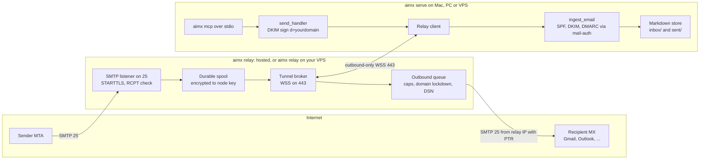
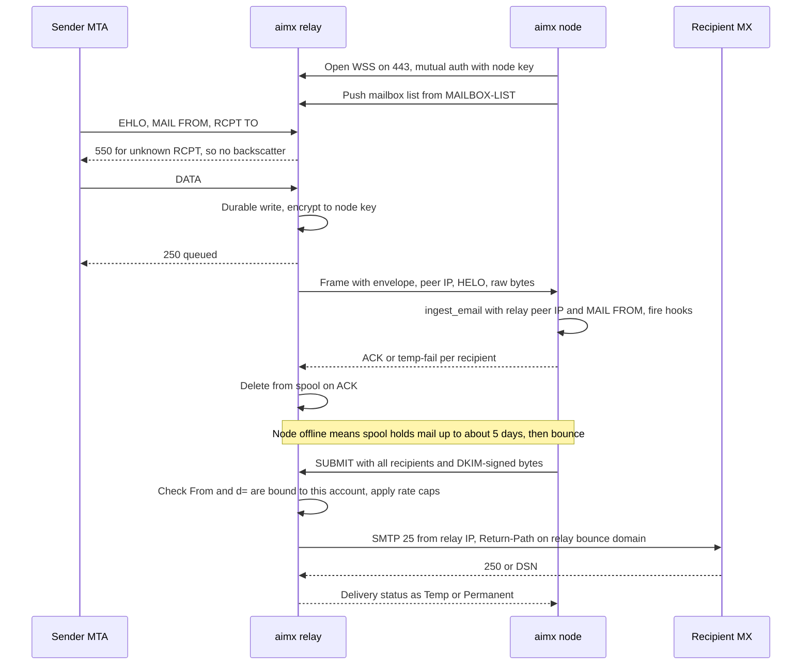
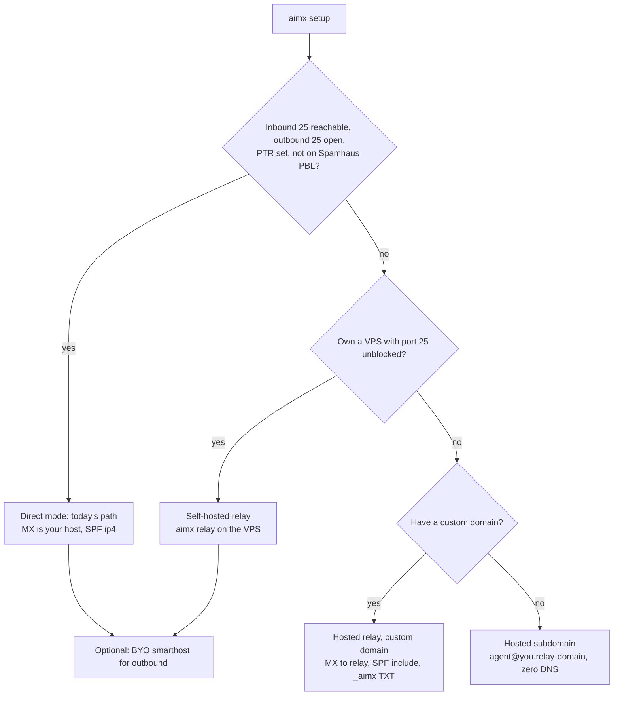
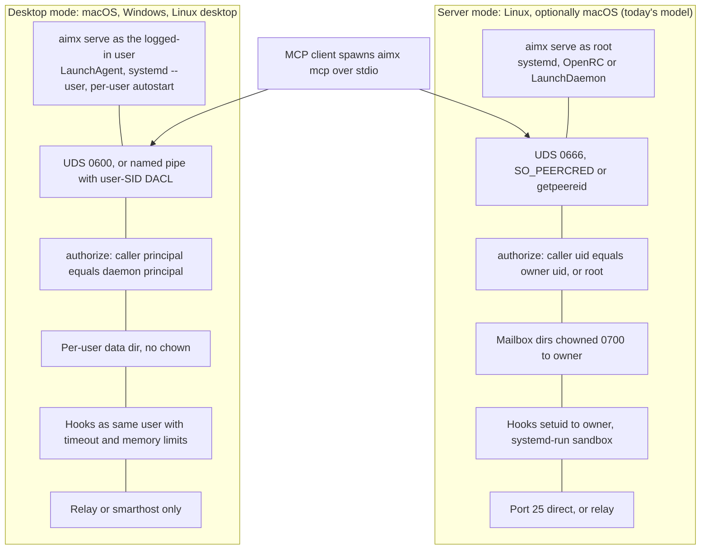

# Win local agents with a relay-backed aimx

**Verdict: yes, build it, but make the hosted relay the product, not the desktop installer.** The opportunity is real in one niche: local, model-agnostic agents (the OpenClaw and Claude Code crowd on Mac minis and laptops) that need their own address on their own domain and don't want a SaaS company holding their mail. The hosted side is crowded and getting cheaper. A vendor-run comparison counts 22 agent-email APIs, and 100 inboxes cost anywhere from $29 to $250 a month ([Dead Simple Email](https://deadsimple.email/compare/pricing.html)). Google and Microsoft are taking the enterprise "AI coworker" mailbox ([TechCrunch](https://techcrunch.com/2026/10/08/google-brings-agentic-ai-to-gemini-starting-with-businesses/), [Microsoft Learn](https://learn.microsoft.com/en-us/microsoft-agent-365/developer/identity)), and Cloudflare gives inbound routing away for free ([Lushbinary](https://lushbinary.com/blog/cloudflare-email-service-vs-aws-ses-agent-email-guide/)). Still, no product we found is a single binary that installs on macOS, Windows and Linux, keeps mail as local files and works without port 25. The closest, agenticmail, needs Node 22, Stalwart running in Docker and a Cloudflare account, and its README doesn't mention Windows ([GitHub](https://github.com/agenticmail/agenticmail)). A relay is required, not optional. AWS, Google Cloud, DigitalOcean, Hetzner, Vultr, Linode and Oracle all block outbound port 25 by default, Azure opens it only on enterprise agreements, and Spamhaus lists residential ranges by policy ([AWS](https://repost.aws/knowledge-center/ec2-port-25-throttle), [DigitalOcean](https://docs.digitalocean.com/support/why-is-smtp-blocked/), [Vultr](https://docs.vultr.com/support/products/compute/why-is-smtp-blocked), [Microsoft Learn](https://learn.microsoft.com/hr-hr/azure/virtual-network/troubleshoot-outbound-smtp-connectivity), [Spamhaus](https://www.spamhaus.org/blocklists/policy-blocklist)). The codebase is unusually ready for this. Outbound already goes through a four-line `MailTransport` trait ([`src/transport.rs:35-38`](https://github.com/uzyn/aimx/blob/e00966c74f6cee4b7821f2d7b8a5717961eee76c/src/transport.rs#L35-L38)). All inbound mail goes through one `ingest_email()` call that takes raw bytes plus envelope metadata ([`src/ingest.rs:129-137`](https://github.com/uzyn/aimx/blob/e00966c74f6cee4b7821f2d7b8a5717961eee76c/src/ingest.rs#L129-L137)). Hook trust depends only on DKIM, which survives a relay hop that doesn't modify the message ([`src/trust.rs:94-96`](https://github.com/uzyn/aimx/blob/e00966c74f6cee4b7821f2d7b8a5717961eee76c/src/trust.rs#L94-L96)). The plan below has six phases (0 to 5) and about 31 to 48 engineer-weeks of work. The main risks are reputation on shared relay IPs, Cloudflare-based clones catching up, and a Windows port that costs more than macOS and Linux combined.

| Question | Short answer |
|---|---|
| Is the opportunity valid? | Yes, for prosumer and small-team agents on their own domains. No for enterprise tenants or high-volume outbound. |
| Does anyone already do exactly this? | No. agenticmail is closest. Hosted APIs keep your data on their servers. The Cloudflare clones require Cloudflare DNS. |
| Is a relay required? | Yes, for nearly every desktop and most cloud VMs. |
| What should be paid? | The hosted relay network: MX, spool, clean outbound IPs. The node and relay code stay open source. |
| Biggest technical lift? | Windows: named pipes, SID-based authorization, Job Objects, code signing. |
| Biggest business risk? | Outbound abuse on shared relay IPs. |
| What ships first? | Bring-your-own smarthost (1 to 2 weeks), plus fixes to the unsafe non-Unix fallbacks. |

## Twenty-plus hosted inboxes, and one gap nobody fills

The "inbox for agents" category formed in 2025 and 2026, and it has a funded leader that is still small. **AgentMail raised a $6M seed led by General Catalyst in March 2026.** It reports "hundreds of thousands" of agent users and 500+ B2B customers but has disclosed no revenue ([TechCrunch](https://techcrunch.com/2026/03/10/agentmail-raises-6m-to-build-an-email-service-for-ai-agents/)), and it has about 10 employees ([TNW](https://thenextweb.com/news/agentmail-raises-6m-seed-ai-agent-email-inboxes)). Since April 2026 the larger players have arrived. **Cloudflare Email Service** entered public beta on 16 April with an open-source Agentic Inbox ([Cloudflare](https://blog.cloudflare.com/email-for-agents/)). **Nylas Agent Accounts** went GA on 17 June ([Nylas](https://developer.nylas.com/docs/changelogs/2026-06-17-agent-accounts-ga/)). **Zoho AgentInbox** opened a waitlist on 13 May ([Zoho](https://www.zoho.com/blog/agentinbox/introducing-zoho-agentinbox.html)). **Google's Gemini agent** gets its own Workspace identity "complete with an email address" ([TechCrunch](https://techcrunch.com/2026/10/08/google-brings-agentic-ai-to-gemini-starting-with-businesses/)). The table compares the products that matter to aimx's decision. Vendor-run comparison sites supplied many of these figures, so treat price and tool counts as vendor-reported.

| Product | Category | Inbound without your own port 25 | Outbound path | Where mail lives | MCP | Platforms / install | Entry price |
|---|---|---|---|---|---|---|---|
| **AgentMail** | Hosted agent-inbox API | Yes, AgentMail is the MX | Shared vendor IPs; dedicated IPs on request ([inboxkit](https://www.inboxkit.com/learn/agentmail-review)) | Vendor cloud | Official remote Streamable HTTP plus stdio bridge ([GitHub](https://github.com/agentmail-to/agentmail-mcp)); 43 tools ([docs](https://docs.agentmail.to/integrations/mcp)) | Any (SaaS) | Free: 3 inboxes, 3,000 emails, no custom domain. $20 for 10 inboxes. $200 for 150 ([usecarly](https://www.usecarly.com/blog/agentmail-pricing/)) |
| **Nylas Agent Accounts** | Hosted mailbox plus calendar | Yes | Vendor | Vendor cloud | Hosted MCP at mcp.us.nylas.com ([Yahoo Finance](https://finance.yahoo.com/technology/ai/articles/nylas-launches-agent-accounts-giving-153200500.html)) | SaaS | Free: 3 accounts. $15 for 10 ([Nylas](https://cli.nylas.com/guides/email-api-pricing-models)) |
| **Resend Inboxes** (private beta) | Transactional ESP moving into inboxes | Yes | Resend | US-only storage ([soleur #9459](https://github.com/jikig-ai/soleur/issues/9459)) | Official stdio and hosted MCP, 18 tool groups ([GitHub](https://github.com/resend/resend-mcp)) | SaaS | Pro $20 for 50k emails; Inboxes price unpublished ([usecarly](https://www.usecarly.com/blog/resend-pricing/)) |
| **Mailtrap Agent Inbox** | ESP moving into inboxes | Only on `@inbound-mailtrap.io`; custom receiving domains "coming soon" ([changelog](https://feedback.mailtrap.io/changelog/inbound-is-generally-available)) | Mailtrap | Vendor cloud | 19 inbound tools ([Mailtrap](https://mailtrap.io/blog/best-inbound-email-api/)) | SaaS | Free 4,000 emails; Basic $15 ([remio](https://www.remio.ai/post/best-inbound-email-api-for-ai-agents-mailtrap-vs-agentmail-vs-postmark)) |
| **Cloudflare Email Service + Agentic Inbox** | Platform primitives plus an open-source reference app | Yes, through Email Routing (free, needs Cloudflare DNS) ([Lushbinary](https://lushbinary.com/blog/cloudflare-email-service-vs-aws-ses-agent-email-guide/)) | Cloudflare sending: 3,000 included, then $0.35 per 1k ([Cloudflare](https://developers.cloudflare.com/email-service/platform/pricing/)) | Your Cloudflare account | `/mcp` endpoint; **no per-mailbox authorization** ([GitHub](https://github.com/cloudflare/agentic-inbox)) | Workers only | Workers Paid |
| **Google Gemini agents / Microsoft agent users** | Enterprise identity | Yes | Tenant | Workspace / M365 | Graph, or none | Tenant only | Gemini: private preview ([Drag](https://www.dragapp.com/blog/gemini-agent/)). Agent 365: $15 per user per month ([Microsoft](https://www.microsoft.com/en-us/security/blog/2026/05/01/microsoft-agent-365-now-generally-available-expands-capabilities-and-integrations/)) |
| **open-agent-email** (OSS) | Self-hosted server | No, its own listener on port 25 | One configured relay (SES, Resend and others) | Your server, SQLite or Postgres | HTTP, 96 tools ([GitHub](https://github.com/Anil-matcha/open-agent-email)) | Docker on Linux | Free |
| **Sentio** (OSS, Rust) | Multi-tenant mail server | No, ports 25/465/587 | Direct MX with DKIM; optional smarthost | Postgres 18, Redis, NATS, S3, ClamAV, rspamd | stdio, 6 tools ([GitHub](https://github.com/truespar/sentio)) | Docker on Linux; MCP binary also for Windows | Free |
| **e2a** (OSS plus hosted) | Self-host or e2a.dev | Hosted relay, or your VPS with port 25; agents use WebSocket "from a laptop or behind a firewall" | Upstream ESP | Postgres | Streamable HTTP with OAuth 2.1 ([GitHub](https://github.com/tokencanopy/e2a)) | Docker | Free / hosted |
| **cf-mailroom, mails, saasmail** (OSS) | Cloudflare Workers apps | Yes, through Cloudflare Email Routing | Cloudflare sending or Resend | D1/R2 in your Cloudflare account | Remote MCP with OAuth ([cf-mailroom](https://github.com/wong2/cf-mailroom)) | Cloudflare only ([mails](https://github.com/chekusu/mails), [saasmail](https://github.com/choyiny/saasmail)) | Workers Paid |
| **agenticmail** (OSS) | Local hybrid; **closest analog** | Yes: polls Gmail IMAP every 30 s, or Cloudflare Email Routing to a Worker to a Cloudflare Tunnel | Local Stalwart direct to MX, or a Gmail SMTP relay | Local Stalwart in Docker | stdio; README gives 80+ to 100 tools ([GitHub](https://github.com/agenticmail/agenticmail)) | macOS (brew plus LaunchAgent), Linux (systemd user); Node 22+; Windows not mentioned | Free |
| **Stalwart / Mox** | General-purpose mail servers | No | Direct, or smarthost | Local | No first-party MCP ([Stalwart](https://github.com/stalwartlabs/stalwart), [Mox](https://github.com/mjl-/mox)) | Stalwart on Linux, macOS and Windows via NSSM ([docs](https://stalw.art/docs/install/platform/windows)); Mox Unix only | Free / Enterprise |
| **Mailbox-wrapper MCPs** | Access to a *human's* mailbox | Not applicable | Human's provider | Provider | stdio, `uvx` one-liners ([mcp-email-server](https://github.com/Wh1isper/mcp-email-server), [google_workspace_mcp](https://github.com/taylorwilsdon/google_workspace_mcp)) | Cross-platform | Free |
| **aimx today** | Single-binary MTA plus MCP | No ([`README.md:57`](https://github.com/uzyn/aimx/blob/e00966c74f6cee4b7821f2d7b8a5717961eee76c/README.md?plain=1#L57)) | Direct to MX on port 25 ([`src/transport.rs:264-272`](https://github.com/uzyn/aimx/blob/e00966c74f6cee4b7821f2d7b8a5717961eee76c/src/transport.rs#L264-L272)) | Local Markdown files | stdio, 12 tools ([`src/mcp.rs`](https://github.com/uzyn/aimx/blob/e00966c74f6cee4b7821f2d7b8a5717961eee76c/src/mcp.rs)) | Linux only ([`install.sh:361-366`](https://github.com/uzyn/aimx/blob/e00966c74f6cee4b7821f2d7b8a5717961eee76c/install.sh#L361-L366)) | Free |
| **aimx proposed** | Open node plus open relay plus paid hosted relay | Yes, through the relay | DKIM signed on the node, delivered by relay or your own smarthost | Local Markdown files | stdio first, broader tool set, optional local HTTP | macOS, Linux, Windows | Node free; relay from $0 |

The open-source field splits three ways. Some projects run their own SMTP listener and need inbound port 25. Some poll an existing IMAP mailbox. Most use Cloudflare Workers with Email Routing. **At least seven open-source projects use Cloudflare Email Routing to avoid port 25**, so any aimx relay will be compared with it ([agenticmail](https://github.com/agenticmail/agenticmail), [cf-mailroom](https://github.com/wong2/cf-mailroom), [saasmail](https://github.com/choyiny/saasmail)). Star counts in this category are noisy. open-agent-email shows 2,099 stars but its repo was created in 2023, before the category existed ([GitHub](https://github.com/Anil-matcha/open-agent-email)). The demand signal that matters is Cloudflare's Agentic Inbox, which reached about 8.3k stars in roughly six months ([GitHub](https://github.com/cloudflare/agentic-inbox)).

aimx's position is unusual. It is one Rust binary with no database. It stores mail as Markdown with TOML frontmatter that agents can read with ordinary file tools, it runs shell hooks on receive and send, and it isolates mailboxes per OS user ([`README.md:193`](https://github.com/uzyn/aimx/blob/e00966c74f6cee4b7821f2d7b8a5717961eee76c/README.md?plain=1#L193)). No hosted competitor lets you keep the data yourself. Every self-hosted competitor stores mail in SQLite, Postgres or D1 and leads with HTTP APIs. Sentio is the closest technical match: Rust, its own SMTP, direct DKIM delivery, stdio MCP. But it needs six infrastructure services and is "built for platforms" ([GitHub](https://github.com/truespar/sentio)). That leaves one gap: install on any OS, use your own domain, keep files local, need neither port 25 nor Docker nor Cloudflare. agenticmail is the only project heading there. It is closest on architecture and furthest on packaging.

## Demand is real, thinly funded, and mostly inbound

The best demand evidence is indirect but consistent. AgentMail says its users **tripled during OpenClaw's breakout week** and quadrupled the following month ([TechCrunch](https://techcrunch.com/2026/03/10/agentmail-raises-6m-to-build-an-email-service-for-ai-agents/)). OpenClaw is a self-hosted personal agent that passed 245k GitHub stars by early March 2026 ([similarlabs](https://similarlabs.com/blog/openclaw-ai-agent-trend-2026)), and its users run on Mac minis that sold out for weeks ([TNW](https://thenextweb.com/news/claude-mac-mini-openclaw-ai-agents-shortage)). Ollama reports 8.9 million monthly developers ([TechCrunch](https://techcrunch.com/2026/07/09/popular-open-source-ai-developer-tool-ollama-raises-65m-grows-to-nearly-9m-users/)). Glama indexes **2,238 email-related MCP servers** ([Glama](https://glama.ai/mcp/best/email)). Taken together, people running agents on their own hardware are buying hosted agent email today because no easy local option exists. No survey or forum dataset directly measures demand for *self-hosted* agent email, and that is the biggest unknown in this verdict.

Use cases explain why a relay is a good fit. The most-cited reason an agent needs its own address is signups, verification codes and 2FA: "nearly anything useful online starts with an email address" ([General Catalyst](https://www.generalcatalyst.com/stories/your-agent-has-mail)). Whole products now exist just to turn OTP mail into JSON ([Lumbox](https://lumbox.co/best-email-api-for-ai-agents/), [openmail.sh](https://openmail.sh/email-verification-api)). OpenClaw setup guides recommend a dedicated Gmail account as the agent's identity ([Substack](https://robertheubanks.substack.com/p/openclaw-on-mac-mini-the-may-2026)), and vendors report Gmail disabling accounts it suspects were "created by a computer program or bot" ([AgentMail](https://www.agentmail.to/blog/what-to-do-if-gmail-bans-your-ai-agent)). These workloads are **inbound-heavy and low-volume**. Relaying inbound mail is cheap and low-risk, and outbound is where the cost and abuse risk sit. Outreach is the exception: it carries the most abuse and legal baggage, and a shared relay should not serve it by default.

Platform risk is serious but uneven. Google bundles agent mailboxes into Workspace with no reported extra charge ([Drag](https://www.dragapp.com/blog/gemini-agent/)), and Microsoft sells Agent 365 at $15 per user per month ([Microsoft](https://www.microsoft.com/en-us/security/blog/2026/05/01/microsoft-agent-365-now-generally-available-expands-capabilities-and-integrations/)), so the enterprise coworker segment is effectively closed to an independent. OpenAI and Anthropic push the opposite pattern, acting inside the human's mailbox: Claude gained Gmail send in August 2026 ([9to5Google](https://9to5google.com/2026/08/18/claude-can-now-send-emails-in-gmail-even-without-your-approval/)). That erodes simple personal-assistant cases but gives the agent no separate identity or reputation. Cloudflare is the sharpest commoditiser for developers, but it only works for Workers and offers no local node. **Nobody first-party targets local, model-agnostic agents on personal domains.** That is aimx's segment.

The case against deserves a fair hearing. AgentMail's $20 tier is cheaper than any engineer's afternoon. Self-hosters rarely pay: Plausible's self-hosted users contributed about **$300 a month in donations** while its cloud reached $1M ARR ([Plausible](https://plausible.io/blog/community-edition), [Plausible](https://plausible.io/blog/open-source-saas)). Adjacent agent-infrastructure companies raise much larger rounds than email does (Browserbase $40M Series B, Natural $30M Series A), which suggests investors see email as a feature-sized layer ([Upstarts](https://www.upstartsmedia.com/p/browserbase-raises-40m-and-launches-director), [TechCrunch](https://techcrunch.com/2026/07/20/natural-raises-30m-to-reinvent-payments-for-ai-agents-and-take-on-stripe/)). The answer is to stop competing on price per inbox and charge for the one thing a home user cannot provide alone: a port-25 edge with clean IPs. Tailscale proves the model, with about **20,000 paying customers out of more than 1M monthly users** ([Globe and Mail](https://www.theglobeandmail.com/business/article-tailscale-tech-vpn-avery-pennarun/)). Twilio now open-sources a self-hosted agent connector that runs on its paid network ([Twilio](https://www.twilio.com/en-us/blog/products/launches/agent-connect)). As an illustration only: 10,000 active nodes at Tailscale's roughly 2% paid rate and $8 a month comes to about $1,600 MRR. That sustains a maintainer, not a venture outcome, and the plan should be sized to match.

## Port 25 blocking makes the relay mandatory

Port 25 is blocked almost everywhere a desktop or cheap VM runs. Relying on submission ports does not fix it either, because some hosts block 465 and 587 too.

| Environment | Outbound port 25 | Path to unblock |
|---|---|---|
| AWS EC2 and Lightsail | Blocked by default | Request form, one per Region ([AWS](https://repost.aws/knowledge-center/ec2-port-25-throttle)) |
| Google Cloud | "Always blocked" | None ([Plesk KB](https://www.plesk.com/kb/support/is-it-possible-to-send-email-directly-from-a-plesk-server-hosted-on-google-cloud/)) |
| Azure | Open only on EA and MCA-E | Blocked on other subscription types ([Microsoft Learn](https://learn.microsoft.com/hr-hr/azure/virtual-network/troubleshoot-outbound-smtp-connectivity)) |
| DigitalOcean | **25, 465 and 587 blocked** | Staff answers conflict ([DigitalOcean](https://docs.digitalocean.com/support/why-is-smtp-blocked/)) |
| Hetzner Cloud | 25 and 465 blocked | Request after one month and a paid invoice ([Discourse quoting Hetzner](https://meta.discourse.org/t/ports-blocked-hetzner-cloud-server/225146?tl=en)) |
| Vultr | Blocked | Ticket, case by case ([Vultr](https://docs.vultr.com/support/products/compute/why-is-smtp-blocked)) |
| Linode / Akamai | 25, 465, 587 restricted for new accounts | Ticket after setting rDNS ([Akamai](https://techdocs.akamai.com/cloud-computing/docs/send-email)) |
| Oracle Cloud | Blocked for tenancies after 2021-06-23 | Limits request ([OCI](https://docs.oracle.com/en-us/iaas/releasenotes/changes/f7e95770-9844-43db-916c-6ccbaf2cfe24)) |
| Comcast residential | Not supported | Use 587 ([Xfinity](https://www.xfinity.com/support/internet/email-port-25-no-longer-supported/)) |
| Any residential IP | Policy-listed on Spamhaus PBL | Send through an authenticated relay ([Spamhaus](https://www.spamhaus.org/blocklists/policy-blocklist)) |

Opening the port would not be enough anyway. Gmail requires every sender to have a PTR record that resolves forward to the same IP ([Google](https://support.google.com/a/answer/81126?hl=en-GB)), which residential lines rarely get. Inbound is harder still, because MX records cannot carry a port, so some host must listen on public TCP 25 ([cPanel](https://support.cpanel.net/hc/en-us/articles/4402368750871-Can-t-receive-emails-in-my-cPanel-server-)). The usual consumer tunnels cannot provide that. Tailscale Funnel listens only on 443, 8443 and 10000 ([Tailscale](https://tailscale.com/docs/features/tailscale-funnel)). ngrok assigns random TCP ports ([ngrok](https://ngrok.com/docs/universal-gateway/cloud-endpoints/tcp)). Cloudflare Tunnel's raw TCP mode needs `cloudflared` on the *client* side, which an arbitrary sending MTA will not run ([Cloudflare](https://developers.cloudflare.com/cloudflare-one/access-controls/applications/non-http/cloudflared-authentication/arbitrary-tcp/)). So the real question is whose host listens on port 25 (ours, Cloudflare's, an ESP's or the user's VPS) and how mail then reaches a node behind NAT. Carrying both directions over HTTPS on port 443 gets around every SMTP-port block in the table, including DigitalOcean's 587 block.

## Put the MX at the edge, keep keys and mail on the node

### One relay protocol for hosted, self-hosted and Cloudflare edges

The design is a relay that terminates SMTP on port 25, holds mail in a durable spool, and talks to the node over a single tunnel that the node opens outbound. The node keeps doing everything it does today: SPF/DKIM/DMARC verification, Markdown storage, hooks, DKIM signing and MCP. The same relay binary should run in three places: a hosted multi-tenant service, a single-tenant `aimx relay` on the user's own VPS, and optionally a Cloudflare Worker adapter for users already on Cloudflare DNS.

### Store-and-forward beats pass-through for laptops that sleep

There are six inbound options. The recommended one queues mail while the node is offline, because senders give up on their own schedules. RFC guidance says to retry for at least 4 to 5 days ([RFC 1123 text](https://freesoft.org/CIE/RFC/1123/107.htm)), but Postmark's inbound webhook stops after 10 attempts over about 10.5 hours ([Postmark](https://postmarkapp.com/support/article/understanding-inbound-webhook-retries-in-postmark)). A laptop asleep overnight would lose mail behind any pass-through design.

| Option | How it works | Node offline | Who sees plaintext | SPF fidelity | Fit |
|---|---|---|---|---|---|
| **A1. Store-and-forward relay plus WSS tunnel** | Relay terminates SMTP, spools, pushes frames; node acks after its own write | Queues for days | Relay in memory; spool encrypted to node key | Relay forwards peer IP, HELO and MAIL FROM; node recomputes | **Recommended** for hosted and self-hosted |
| A2. L4 pass-through (frp or rathole plus PROXY v2) | Raw TCP 25 over a tunnel to the node's existing `smtp/` | No queue; relies on sender retries | Only the node, if the sender used STARTTLS | PROXY v2 header ([frp](https://gofrp.org/en/docs/features/common/realip/)) | Stopgap for single-tenant power users |
| A3. Hybrid | Pass-through when connected, spool when not | Queues | Relay only while spooling | Both paths | Later optimization |
| A4. Cloudflare Email Routing Worker to Durable Object to node | Worker `email()` handler stores, node pulls over WSS | Queues in Cloudflare | Cloudflare | Client IP lost; trust Cloudflare's ARC ([Cloudflare](https://blog.cloudflare.com/email-routing-subdomains/)) | Optional adapter; 25 MiB and 200-rule limits ([Cloudflare](https://developers.cloudflare.com/email-routing/limits)) |
| A5. ESP inbound into a pull queue | SES to S3, or Postmark/Resend webhooks | Depends on ESP; Postmark about 10.5 h | ESP | ESP verdicts | Niche "bring your own cloud" |
| A6. User's VPS with WireGuard DNAT | DIY port forwarding ([mynacol](https://blog.mynacol.xyz/en/mail-server-at-home/)) | None | Node | Real IP if DNAT is used | Documentation only |

A1 does give up one property. In every relay design except pure pass-through, the relay operator sees plaintext, because SMTP TLS protects only one hop at a time. Encrypting each message to the node's public key right after DATA keeps the spool unreadable, but the relay still handles the bytes in memory. The positioning must say so honestly. SPF is the other constraint. It must be checked against the IP that actually connected to the MX, and only the relay sees that, so the relay forwards it as authenticated metadata and the node recomputes the verdicts with the same `mail-auth` code it uses today ([`src/ingest.rs:777-823`](https://github.com/uzyn/aimx/blob/e00966c74f6cee4b7821f2d7b8a5717961eee76c/src/ingest.rs#L777-L823)). In relay mode the node must never fall back to parsing the spoofable `Received:` header, which `select_spf_inputs` does today whenever the peer IP is unspecified ([`src/ingest.rs:835-852`](https://github.com/uzyn/aimx/blob/e00966c74f6cee4b7821f2d7b8a5717961eee76c/src/ingest.rs#L835-L852)).

### Node-signed DKIM keeps DMARC aligned on someone else's IPs

On outbound, the node should keep signing with the user's own key, as it does today ([`src/send_handler.rs:291-295`](https://github.com/uzyn/aimx/blob/e00966c74f6cee4b7821f2d7b8a5717961eee76c/src/send_handler.rs#L291-L295)). DMARC then passes on DKIM alignment even when the relay uses its own bounce domain. The relay may add a second signature for feedback-loop attribution, as Amazon SES does on every message ([AWS](https://docs.aws.amazon.com/ses/latest/dg/send-email-authentication-dkim-manual.html)). The most important lesson comes from MailChannels. A shared SPF include let any customer spoof any other customer's domain, and a 2023 report counted about 2 million domains exposed ([Solace Global](https://www.solaceglobal.com/news/2023/09/21/cyber-security-alert-do-you-use-mailchannels-2m-domains-open-to-phishing-attacks/)). The fix was the mandatory "Domain Lockdown" TXT record ([MailChannels](https://docs.mailchannels.com/outbound/spf-records.md)). The aimx relay needs the same binding from day one.

| Option | DKIM signer | Who carries IP reputation | Abuse burden on us | Fit |
|---|---|---|---|---|
| **B1. Node-signed DKIM, relay delivers** | Node; key never leaves the machine | Relay IPs | High | Hosted relay paid tiers |
| B2. Relay-signed DKIM (CNAME to a relay key) | Relay | Relay IPs | High, plus a larger trust surface | Only for zero-DNS hosted subdomains |
| **B3. Bring your own ESP or smarthost** | Node, plus the ESP's own signature | The ESP | None | **Ship first**; covers VPS users today |
| B4. Self-hosted single-tenant relay on a VPS | Node | User's VPS IP | None | Open-source default for power users |

### The code already has the seams

The codebase audit found that both directions already have clean entry points. The work is mostly new implementations behind existing interfaces, plus setup changes.

| Change | Where it lands | Notes |
|---|---|---|
| `SmarthostTransport` plus an `[outbound]` config block | Trait at [`src/transport.rs:35-38`](https://github.com/uzyn/aimx/blob/e00966c74f6cee4b7821f2d7b8a5717961eee76c/src/transport.rs#L35-L38); transport chosen by env var at [`src/serve.rs:503-521`](https://github.com/uzyn/aimx/blob/e00966c74f6cee4b7821f2d7b8a5717961eee76c/src/serve.rs#L503-L521); `Config` has no outbound fields ([`src/config.rs:124-160`](https://github.com/uzyn/aimx/blob/e00966c74f6cee4b7821f2d7b8a5717961eee76c/src/config.rs#L124-L160)) | lettre already exposes `starttls_relay`, `.credentials()`, `.port()` |
| `RelayTransport` (tunnel SUBMIT) | Single call site [`src/send_handler.rs:326`](https://github.com/uzyn/aimx/blob/e00966c74f6cee4b7821f2d7b8a5717961eee76c/src/send_handler.rs#L326); sync trait bridged with `block_in_place` ([`src/transport.rs:149-160`](https://github.com/uzyn/aimx/blob/e00966c74f6cee4b7821f2d7b8a5717961eee76c/src/transport.rs#L149-L160)) | Make the trait async and pass every envelope recipient; today one bare recipient is taken from `To:` ([`src/send_handler.rs:213-236`](https://github.com/uzyn/aimx/blob/e00966c74f6cee4b7821f2d7b8a5717961eee76c/src/send_handler.rs#L213-L236)) and there is no retry queue |
| `RelayTunnelSource` for inbound | Call `ingest_email` ([`src/ingest.rs:129-137`](https://github.com/uzyn/aimx/blob/e00966c74f6cee4b7821f2d7b8a5717961eee76c/src/ingest.rs#L129-L137)) in `spawn_blocking`, as the SMTP session does ([`src/smtp/session.rs:532-560`](https://github.com/uzyn/aimx/blob/e00966c74f6cee4b7821f2d7b8a5717961eee76c/src/smtp/session.rs#L532-L560)) | Mirror the 250/451 per-recipient contract as tunnel ACKs |
| Relay-mode SPF inputs | [`src/ingest.rs:835-852`](https://github.com/uzyn/aimx/blob/e00966c74f6cee4b7821f2d7b8a5717961eee76c/src/ingest.rs#L835-L852) | Use relay IP and envelope; disable `Received:` fallback |
| Recipient validation at the relay | `resolve_recipient_mailbox` ([`src/ingest.rs:80`](https://github.com/uzyn/aimx/blob/e00966c74f6cee4b7821f2d7b8a5717961eee76c/src/ingest.rs#L80)); MAILBOX-LIST verb already exists | Node pushes its mailbox list over the tunnel |
| Setup route branch | Hard-fail port-25 preflight ([`src/setup.rs:2462-2470`](https://github.com/uzyn/aimx/blob/e00966c74f6cee4b7821f2d7b8a5717961eee76c/src/setup.rs#L2462-L2470)); `hostname -I` ([`src/setup.rs:885`](https://github.com/uzyn/aimx/blob/e00966c74f6cee4b7821f2d7b8a5717961eee76c/src/setup.rs#L885)); `generate_dns_records` ([`src/setup.rs:1018-1069`](https://github.com/uzyn/aimx/blob/e00966c74f6cee4b7821f2d7b8a5717961eee76c/src/setup.rs#L1018-L1069)); `verify_mx` requires MX = domain ([`src/setup.rs:1107-1123`](https://github.com/uzyn/aimx/blob/e00966c74f6cee4b7821f2d7b8a5717961eee76c/src/setup.rs#L1107-L1123)); `spf_contains_ip` understands only `ip4:`/`ip6:` ([`src/setup.rs:1151-1166`](https://github.com/uzyn/aimx/blob/e00966c74f6cee4b7821f2d7b8a5717961eee76c/src/setup.rs#L1151-L1166)) | Add `include:` support and relay MX acceptance |
| Readiness probe off port 25 | `127.0.0.1:25` probe ([`src/setup.rs:574-592`](https://github.com/uzyn/aimx/blob/e00966c74f6cee4b7821f2d7b8a5717961eee76c/src/setup.rs#L574-L592)), reused by upgrade ([`src/upgrade.rs:346`](https://github.com/uzyn/aimx/blob/e00966c74f6cee4b7821f2d7b8a5717961eee76c/src/upgrade.rs#L346)) | Probe the UDS or named pipe instead |
| New `services/relay` crate | Reuse [`src/smtp/session.rs`](https://github.com/uzyn/aimx/blob/e00966c74f6cee4b7821f2d7b8a5717961eee76c/src/smtp/session.rs) (779-line state machine) and `mail-auth`; borrow deployment scaffolding from [`services/verifier`](https://github.com/uzyn/aimx/tree/e00966c74f6cee4b7821f2d7b8a5717961eee76c/services/verifier) | The verifier itself handles no DATA, storage or tenancy, so it is not a foundation |

Two facts make the trust model hold up behind a relay. Hook gating checks only `dkim == "pass"` plus the sender allowlist ([`src/trust.rs:94-96`](https://github.com/uzyn/aimx/blob/e00966c74f6cee4b7821f2d7b8a5717961eee76c/src/trust.rs#L94-L96)), and DKIM verifies on unmodified bytes wherever it runs. As long as the relay only prepends headers and never rewrites the body or signed headers, `on_receive` hooks fire exactly as they do in direct mode.

### Setup chooses a route instead of failing on port 25

Today `aimx setup` treats port 25 as a hard prerequisite. In the new design it becomes one branch of a route selector. The verifier already probes port reachability ([`services/verifier/src/main.rs:212-262`](https://github.com/uzyn/aimx/blob/e00966c74f6cee4b7821f2d7b8a5717961eee76c/services/verifier/src/main.rs#L212-L262)), so it can grow into the mode selector by also checking PTR and PBL listing.

| DNS record | Direct (today) | Relay, custom domain | Hosted subdomain |
|---|---|---|---|
| A / AAAA | Server IP | Not required | Relay operator's |
| MX | `10 <domain>.` | `10 mx.<relay>.` | Wildcard MX on the relay domain |
| SPF | `v=spf1 ip4:<ip> -all` | `v=spf1 include:_spf.<relay> -all` | Relay operator's |
| DKIM | Node key TXT | Node key TXT, unchanged | Relay-published key |
| DMARC | `p=reject` | Start at `p=none` or `quarantine` until delivery is verified | Relay operator's |
| Ownership binding | None | `_aimx.<domain>` TXT naming the account | Not needed |

Hosted subdomains are the only zero-DNS, zero-port-25 path, and they are how competitors remove onboarding friction. AgentMail defaults to `@agentmail.to` and Resend offers `*.resend.app` for receiving ([AgentMail](https://www.agentmail.to/blog/custom-domains-for-thousands-of-agent-inboxes), [Resend](https://resend.com/blog/inbound-emails)). The cost is shared reputation, and AgentMail warns that its shared domain carries one ([AgentMail](https://www.agentmail.to/docs/knowledge-base/emails-going-to-spam)). Some recipients now send agent-email domains straight to Junk ([coryd.dev](https://www.coryd.dev/posts/2026/agent-email-is-spam)). Hosted subdomains therefore belong on a separate registrable domain, never on aimx.email. Custom domains should stay the recommended path.

## Desktop mode replaces Unix users with a single principal

Today all authorization is one pure predicate. uid 0 bypasses everything, and every other caller must match the mailbox owner's `getpwnam` uid ([`src/auth.rs:196-243`](https://github.com/uzyn/aimx/blob/e00966c74f6cee4b7821f2d7b8a5717961eee76c/src/auth.rs#L196-L243)). The caller's uid comes from SO_PEERCRED on a world-writable socket ([`src/uds_authz.rs:182-187`](https://github.com/uzyn/aimx/blob/e00966c74f6cee4b7821f2d7b8a5717961eee76c/src/uds_authz.rs#L182-L187), [`src/serve.rs:717-737`](https://github.com/uzyn/aimx/blob/e00966c74f6cee4b7821f2d7b8a5717961eee76c/src/serve.rs#L717-L737)). Storage is chowned per owner ([`src/ownership.rs:73-95`](https://github.com/uzyn/aimx/blob/e00966c74f6cee4b7821f2d7b8a5717961eee76c/src/ownership.rs#L73-L95)), and hooks `setuid` to the owner ([`src/platform.rs:319-341`](https://github.com/uzyn/aimx/blob/e00966c74f6cee4b7821f2d7b8a5717961eee76c/src/platform.rs#L319-L341)). On a single-user desktop, all of this collapses into one principal: the daemon runs as the logged-in user, the IPC endpoint is restricted to that user, and every mailbox implicitly belongs to that user. The README already says aimx is "designed for a single operator (you) and a single domain" ([`README.md:277`](https://github.com/uzyn/aimx/blob/e00966c74f6cee4b7821f2d7b8a5717961eee76c/README.md?plain=1#L277)), so desktop mode fits the product as it is.

### Two unsafe fallbacks must be fixed before any non-Unix build ships

The audit found two `cfg(not(unix))` fallbacks that would become security bugs if a Windows build shipped as-is. First, `current_euid()` returns 0 off Unix ([`src/platform.rs:35-45`](https://github.com/uzyn/aimx/blob/e00966c74f6cee4b7821f2d7b8a5717961eee76c/src/platform.rs#L35-L45)). The MCP server builds its caller identity from that value ([`src/mcp.rs:222`](https://github.com/uzyn/aimx/blob/e00966c74f6cee4b7821f2d7b8a5717961eee76c/src/mcp.rs#L222)), and `authorize` treats uid 0 as a blanket bypass ([`src/auth.rs:201-203`](https://github.com/uzyn/aimx/blob/e00966c74f6cee4b7821f2d7b8a5717961eee76c/src/auth.rs#L201-L203)), so every Windows caller would count as root. Second, the DKIM private key is written with a plain `std::fs::write` and no ACL ([`src/dkim.rs:125-129`](https://github.com/uzyn/aimx/blob/e00966c74f6cee4b7821f2d7b8a5717961eee76c/src/dkim.rs#L125-L129)). Both should become compile errors or route through an explicit `DeploymentMode::Desktop`, never degrade silently. The audit also found unconditional Unix imports and signal handlers that almost certainly stop the crate from compiling on Windows today ([`src/uds_authz.rs:20-21`](https://github.com/uzyn/aimx/blob/e00966c74f6cee4b7821f2d7b8a5717961eee76c/src/uds_authz.rs#L20-L21), [`src/serve.rs:629-634`](https://github.com/uzyn/aimx/blob/e00966c74f6cee4b7821f2d7b8a5717961eee76c/src/serve.rs#L629-L634), [`src/user_resolver.rs:30-50`](https://github.com/uzyn/aimx/blob/e00966c74f6cee4b7821f2d7b8a5717961eee76c/src/user_resolver.rs#L30-L50)). It did not test this by compiling for Windows. A `cargo check --target x86_64-pc-windows-msvc` job on a Windows CI runner would give the exact list.

### Per-OS mechanics

| Concern | Linux server (today) | macOS | Windows | Linux desktop |
|---|---|---|---|---|
| Service | systemd or OpenRC unit ([`src/serve.rs:970-1035`](https://github.com/uzyn/aimx/blob/e00966c74f6cee4b7821f2d7b8a5717961eee76c/src/serve.rs#L970-L1035)) | LaunchDaemon for server mode, LaunchAgent for desktop ([Apple](https://developer.apple.com/library/archive/documentation/MacOSX/Conceptual/BPSystemStartup/Chapters/CreatingLaunchdJobs.html)) | Per-user autostart like Ollama's no-admin installer ([Ollama](https://github.com/ollama/ollama/blob/main/docs/windows.mdx)); SCM service via `windows-service` later ([docs.rs](https://docs.rs/windows-service)) | `systemd --user` plus `loginctl enable-linger` ([etbe](https://etbe.coker.com.au/2026/07/24/systemd-linger/)) |
| IPC | UDS at `/run/aimx`, mode 0666 | UDS works as-is; move it out of `/run` | **Named pipe with an explicit SDDL**; tokio has no AF_UNIX on Windows, "no plans" ([tokio #2201](https://github.com/tokio-rs/tokio/issues/2201)) | UDS in `$XDG_RUNTIME_DIR`, mode 0600 |
| Caller identity | SO_PEERCRED | `getpeereid` through tokio `peer_cred()` ([tokio](https://github.com/tokio-rs/tokio/blob/master/tokio/src/net/unix/ucred.rs)) | Impersonate the client token and read its SID, as Tailscale does ([Tailscale](https://github.com/tailscale/tailscale/blob/main/safesocket/pipe_windows.go)); never trust the PID, which can be spoofed ([Project Zero](https://projectzero.google/2019/09/windows-exploitation-tricks-spoofing.html)) | SO_PEERCRED |
| Hook isolation | systemd-run or fork+setuid ([`src/platform.rs:150-240`](https://github.com/uzyn/aimx/blob/e00966c74f6cee4b7821f2d7b8a5717961eee76c/src/platform.rs#L150-L240)) | Same user under a generated `sandbox-exec` profile; deprecated but still used by Codex and Claude Code ([gastown.dev](https://gastown.dev/docs/research/macos-sandbox-exec)) | Job Object for timeout and memory only; OpenAI still calls Codex's Windows sandbox experimental ([OpenAI](https://developers.openai.com/codex/sandbox)) | Landlock as an unprivileged fallback ([docs.rs](https://docs.rs/landlock)) |
| Port 25 (direct mode) | Root binds it | Non-root can bind privileged ports on the wildcard address since Mojave ([Apple forums](https://developer.apple.com/forums/thread/674179)) | Contested; desktop mode uses the relay anyway | Needs a capability; relay mode avoids it |
| Paths | `/etc/aimx`, `/var/lib/aimx` ([`src/config.rs:38-39`](https://github.com/uzyn/aimx/blob/e00966c74f6cee4b7821f2d7b8a5717961eee76c/src/config.rs#L38-L39)) | `~/Library/Application Support/aimx` | `%LOCALAPPDATA%\aimx` | `$XDG_DATA_HOME/aimx` ([directories](https://github.com/dirs-dev/directories-rs)) |

Relay mode also opens a rootless Linux server mode. The daemon runs as root today mainly because it binds port 25, and a test asserts exactly that: "User=root remains; the daemon still binds port 25" ([`src/serve.rs:1400`](https://github.com/uzyn/aimx/blob/e00966c74f6cee4b7821f2d7b8a5717961eee76c/src/serve.rs#L1400)). On macOS, root daemons get automatic local-network access ([Apple forums](https://developer.apple.com/forums/thread/767391)), and launch agents would only be prompted for LAN destinations, not internet MX hosts. That last point is inferred and should be tested. On Windows, Tailscale's history is the warning to heed. Its LocalAPI used to listen on localhost TCP, which led to CVE-2022-41924 ([INCIBE](https://www.incibe.es/index.php/en/incibe-cert/early-warning/vulnerabilities/cve-2022-41924)). Privileged control planes belong on ACL'd pipes, not loopback ports.

### Seven seams cover nearly all the platform work

| Seam | Today | New implementations |
|---|---|---|
| `ServiceManager` | systemd/OpenRC writers in [`src/setup.rs:441-500`](https://github.com/uzyn/aimx/blob/e00966c74f6cee4b7821f2d7b8a5717961eee76c/src/setup.rs#L441-L500) | launchd, `systemd --user`, Windows autostart and SCM; `service-manager` crate as a starting point ([GitHub](https://github.com/chipsenkbeil/service-manager-rs)) |
| `Ipc` + `PeerIdentity` | `UnixListener`/`UnixStream` leak into [`src/serve.rs:745-835`](https://github.com/uzyn/aimx/blob/e00966c74f6cee4b7821f2d7b8a5717961eee76c/src/serve.rs#L745-L835) and clients ([`src/send.rs:240`](https://github.com/uzyn/aimx/blob/e00966c74f6cee4b7821f2d7b8a5717961eee76c/src/send.rs#L240)) | tokio UDS on Unix plus tokio named pipes on Windows, behind an aimx trait. `interprocess` hides peer credentials and its author refuses support to LLM-based projects ([GitHub](https://github.com/kotauskas/interprocess)) |
| `Principal`-based `authorize` | `caller_uid: u32` ([`src/auth.rs:196`](https://github.com/uzyn/aimx/blob/e00966c74f6cee4b7821f2d7b8a5717961eee76c/src/auth.rs#L196)) | `Root`, `Uid(u32)`, `Sid(String)`, `DesktopUser` |
| `StoragePolicy` | `chown_as_owner` called from five modules ([`src/ownership.rs:73-95`](https://github.com/uzyn/aimx/blob/e00966c74f6cee4b7821f2d7b8a5717961eee76c/src/ownership.rs#L73-L95)) | Unix owner policy, Windows ACL, desktop no-op |
| `HookExecutor` | `spawn_sandboxed`; returns `Unsupported` off Unix ([`src/platform.rs:353-366`](https://github.com/uzyn/aimx/blob/e00966c74f6cee4b7821f2d7b8a5717961eee76c/src/platform.rs#L353-L366)) | SystemdRun, ForkSetuid, SameUser (setsid plus rlimits plus Seatbelt or Landlock), WindowsJob |
| `MailTransport` variants | Direct only ([`src/transport.rs:50-185`](https://github.com/uzyn/aimx/blob/e00966c74f6cee4b7821f2d7b8a5717961eee76c/src/transport.rs#L50-L185)) | Smarthost, RelayTunnel |
| `InboundSource` | SMTP listener only ([`src/serve.rs:572`](https://github.com/uzyn/aimx/blob/e00966c74f6cee4b7821f2d7b8a5717961eee76c/src/serve.rs#L572)) | RelayTunnel, both feeding `ingest_email` |

## Signing and packaging cost dollars; the Windows port costs months

Distribution today means four Linux targets built with `cross` ([`.github/workflows/release.yml:15-25`](https://github.com/uzyn/aimx/blob/e00966c74f6cee4b7821f2d7b8a5717961eee76c/.github/workflows/release.yml#L15-L25)). `install.sh` rejects any non-Linux `uname` ([`install.sh:361-366`](https://github.com/uzyn/aimx/blob/e00966c74f6cee4b7821f2d7b8a5717961eee76c/install.sh#L361-L366)), and CI runs only on `ubuntu-latest` ([`.github/workflows/ci.yml:13-38`](https://github.com/uzyn/aimx/blob/e00966c74f6cee4b7821f2d7b8a5717961eee76c/.github/workflows/ci.yml#L13-L38)). cargo-dist covers most of the new matrix. Version 0.33.0 (September 2026) builds shell, PowerShell, Homebrew, npm and MSI installers and added Azure Artifact Signing ([cargo-dist](https://github.com/axodotdev/cargo-dist/releases)). It does not produce .deb, .rpm or macOS .pkg files, and its MSI does not install services ([cargo-dist book](https://github.com/axodotdev/cargo-dist/blob/main/book/src/installers/msi.md)). Its updater is experimental ([cargo-dist book](https://github.com/axodotdev/cargo-dist/blob/main/book/src/installers/updater.md)), so aimx should keep its own `upgrade` command. That command already picks tarballs by the target triple embedded in the version string ([`src/upgrade.rs:265-266`](https://github.com/uzyn/aimx/blob/e00966c74f6cee4b7821f2d7b8a5717961eee76c/src/upgrade.rs#L265-L266)).

| Channel | Cost | Friction | Recommendation |
|---|---|---|---|
| macOS Homebrew tap formula with a `service` block | $0 | Low; `brew services` maps to launchd ([simplified.guide](https://www.simplified.guide/homebrew/service-start-stop)) | **Primary macOS channel.** Homebrew's September 2026 Gatekeeper rule targets casks ([AlternativeTo](https://alternativeto.net/news/2025/11/homebrew-5-0-brings-download-concurrency-by-default-linux-arm64-aarch64-support-and-more/)) |
| macOS `curl \| sh` | $0 | `curl` downloads are not quarantined, so Gatekeeper does not check them ([Apple forums](https://developer.apple.com/forums/thread/666452)) | Keep, extended from `install.sh` |
| macOS Developer ID signed, notarized `.pkg` | $99 per year ([flaviocopes](https://flaviocopes.com/apple-developer-free-vs-paid/)) | A bare CLI cannot have a notarization ticket stapled; Apple suggests a pkg ([Apple forums](https://developer.apple.com/forums/thread/757647)). Sequoia removed the Control-click override ([The Hacker News](https://thehackernews.com/2024/08/apples-new-macos-sequoia-tightens.html)) | Later, for non-technical users |
| Windows zip on winget plus `irm \| iex` | $0 | winget accepts zip packages in practice ([wingetly](https://wingetly.io/apps/axodotdev/dist)) | First Windows channel |
| Windows Authenticode signing | Azure Artifact Signing $9.99 per month ([Azure](https://azure.microsoft.com/cs-cz/pricing/details/artifact-signing/)) | Individuals must be in the US or Canada; organizations in more countries ([Microsoft Learn](https://learn.microsoft.com/en-us/azure/artifact-signing/quickstart)). EV no longer bypasses SmartScreen, and reputation is per file hash ([Microsoft Learn](https://learn.microsoft.com/et-ee/windows/apps/package-and-deploy/smartscreen-reputation)) | Sign through an organization entity; otherwise buy an OV certificate |
| Linux .deb / .rpm | $0 | cargo-deb ships systemd units directly ([cargo-deb](https://github.com/kornelski/cargo-deb)) | Add alongside `install.sh` |
| MCPB bundle for Claude Desktop | $0 | Binary bundles with per-platform overrides ([mcpb](https://github.com/modelcontextprotocol/mcpb/blob/main/MANIFEST.md)) | Client shim only; the daemon must already be installed |

The dollar costs are small: about $99 a year for Apple plus about $120 a year for Windows signing. The engineering cost is uneven. Stalwart, the closest Rust mail-server peer, writes a launchd unit on macOS from the same `install.sh` it uses for Linux, but on Windows it falls back to NSSM ([Stalwart](https://stalw.art/docs/install/platform/windows)). That shows where peer projects take shortcuts. The audit estimates the macOS port at 3 to 5 engineer-weeks and Windows at 6 to 10, because Windows needs a new IPC transport, a new principal model, a hook executor, ACLs, an installer and signing all at once.

## MCP needs an OTP loop, client installers and a carefully guarded HTTP endpoint

aimx exposes 12 stdio tools ([`src/mcp.rs`](https://github.com/uzyn/aimx/blob/e00966c74f6cee4b7821f2d7b8a5717961eee76c/src/mcp.rs)). AgentMail ships 43 ([AgentMail](https://docs.agentmail.to/integrations/mcp)), Mailtrap 19 inbound tools ([Mailtrap](https://mailtrap.io/blog/best-inbound-email-api/)) and Resend 18 tool groups ([GitHub](https://github.com/resend/resend-mcp)), and the leaders now lead with remote Streamable HTTP. Matching tool counts is the wrong goal. The useful additions are the ones that make the inbound-heavy use cases work. **stdio should stay the primary transport.** The 2026-07-28 spec says stdio implementations should "retrieve credentials from the environment" rather than run OAuth ([MCP spec](https://github.com/modelcontextprotocol/modelcontextprotocol/blob/main/docs/specification/2026-07-28/basic/authorization/index.mdx)), and a client-spawned `aimx mcp` carries the OS identity that the daemon's peer-credential check depends on.

| Addition | Why | Precedent |
|---|---|---|
| `email_wait` (long-poll with sender and subject filters) | Signup and OTP flows block on one incoming message | DevInbox long-poll ([devinbox](https://devinbox.io/articles/agentmail-alternatives.html)) |
| `email_extract_codes` / links | Deterministic OTP and confirmation-link extraction | Lumbox OTP-to-JSON ([Lumbox](https://lumbox.co/best-email-api-for-ai-agents/)) |
| `thread_list` / `thread_get` | Agents reason in conversations | AgentMail's core loop includes `list_threads` ([AgentMail](https://www.agentmail.to/blog/how-to-use-mcp-with-an-email-api)) |
| `attachment_get` | Bundle directories exist but are not addressable by tool | Resend received-attachment download ([GitHub](https://github.com/resend/resend-mcp)) |
| Draft plus approval gate for outbound | Contains damage from prompt-injected agents | Agentic Inbox requires explicit confirmation to send ([GitHub](https://github.com/cloudflare/agentic-inbox)); e2a has `pending_review` ([GitHub](https://github.com/tokencanopy/e2a)) |
| Outbound recipient allowlists and per-hour caps per mailbox | Node-side abuse brake before the relay's | agent-mail-gateway ([GitHub](https://github.com/dominikamann/agent-mail-gateway)) |
| `delivery_status` | Relay mode makes delivery asynchronous | Relay DSN frames (this design) |

Installing into clients matters as much as the tool list. `aimx agents setup` already embeds per-agent bundles and resolves `$HOME`-based destinations ([`src/agents_setup.rs:76-123`](https://github.com/uzyn/aimx/blob/e00966c74f6cee4b7821f2d7b8a5717961eee76c/src/agents_setup.rs#L76-L123)). It should also write each client's MCP entry in that client's native format and path on each OS: `servers` with `type` for VS Code ([VS Code](https://code.visualstudio.com/docs/copilot/chat/mcp-servers)), TOML `mcp_servers` for Codex ([openai/codex](https://github.com/openai/codex/pull/4811/files)), YAML `extensions` for Goose ([Goose](https://goose-docs.ai/docs/guides/config-files)). A binary `.mcpb` gives Claude Desktop one-click install ([mcpb](https://github.com/modelcontextprotocol/mcpb)), and the official registry accepts MCPB packages, although it is still in preview ([MCP Registry](https://modelcontextprotocol.io/registry/package-types)).

A localhost Streamable HTTP endpoint is worth adding later, and only for clients that cannot spawn processes. The spec says servers "MUST validate the Origin header" and "SHOULD bind only to localhost" ([MCP spec](https://github.com/modelcontextprotocol/modelcontextprotocol/blob/main/docs/specification/2026-07-28/basic/transports/streamable-http.mdx)). CVE-2025-49596, a CVSS 9.6 remote code execution in MCP Inspector caused by a missing local proxy auth check, shows the cost of getting this wrong ([NVD](https://nvd.nist.gov/vuln/detail/CVE-2025-49596)). A relay-proxied remote MCP is a further option and would be a real differentiator: cloud agents reach the node over the tunnel and mail is never stored in the cloud. It needs OAuth 2.1 and should wait until the hosted relay is stable. Prompt injection through inbound mail was outside the research scope and needs its own study. For now, every tool result should carry the frontmatter's `trusted` and `dkim` fields so the agent can tell a verified sender from a stranger.

## Abuse controls decide whether the relay survives its first year

A shared outbound relay is an abuse-operations business that happens to involve code. MailChannels ran a free sending relay for Cloudflare Workers from 2022, made Domain Lockdown mandatory amid the cross-tenant spoofing exposure, and shut the free service down on 31 August 2024 ([MailChannels](https://blog.mailchannels.com/important-update-mailchannels-email-sending-api-for-cloudflare-workers-to-be-terminated/)). Mailbox providers now enforce rules from the first message. Gmail requires every sender to have SPF or DKIM, PTR and TLS, and to keep spam under 0.3% ([Google](https://support.google.com/a/answer/81126?hl=en-GB)). Microsoft enforces SPF, DKIM and DMARC on consumer Outlook for senders above 5,000 messages a day since 5 May 2025 ([Microsoft](https://substrate.office.com/ip-domain-management-snds/Postmaster/Policies)). Agent-email vendors learned this early. AgentMail began with no controls on account creation and now limits unverified inboxes to 10 emails a day ([TechCrunch](https://techcrunch.com/2026/03/10/agentmail-raises-6m-to-build-an-email-service-for-ai-agents/), [TNW](https://thenextweb.com/news/agentmail-raises-6m-seed-ai-agent-email-inboxes)). AI agents add a twist: a prompt-injected agent can produce new spam at machine speed, so the relay must treat every node as possibly compromised.

| Control | Default | Modeled on |
|---|---|---|
| Domain binding: `_aimx.<domain>` TXT names the account; reject any From or DKIM `d=` not bound to it | Mandatory | MailChannels Domain Lockdown ([MailChannels](https://docs.mailchannels.com/outbound/spf-records.md)) |
| New-account outbound cap with manual review to step up | Low daily cap; queue or reject above it | SMTP2GO 1,000-email cap plus review ([SMTP2GO](https://support.smtp2go.com/hc/en-gb/articles/223087427-New-Account-Limits-and-the-Review-Process)) |
| Free tier is inbound-heavy; outbound only to verified owner addresses or a tiny cap | Generous inbound | ImprovMX free: receive 500 a day, send 0 ([ImprovMX](https://help.improvmx.com/en/articles/4342296-what-are-the-sending-receiving-limits)); Cloudflare free sends to verified destinations ([Cloudflare](https://developers.cloudflare.com/email-service/platform/pricing/)) |
| Per-node behavioral scoring with automatic suspension | Pause at about 0.1% complaints or 2% bounces | MailChannels per-sender reputation ([MailChannels](https://docs.mailchannels.com/outbound/overview)); per-agent thresholds ([Mails.ai](https://mails.ai/blog/agent-email-firewall)) |
| Hard daily caps that stop sending, not queue | Per tier | ImprovMX stops until 00:00 UTC ([ImprovMX](https://help.improvmx.com/en/articles/4342296-what-are-the-sending-receiving-limits)) |
| Verified sender requirement | Mandatory | SMTP2GO since 2025-04-11 ([SMTP2GO](https://www.smtp2go.com/blog/registering-a-verified-sender-is-now-a-required-action/)) |
| Feedback-ID header and FBL enrollment | On | Gmail Postmaster Tools complaint data requires Feedback-ID ([customer.io](https://docs.customer.io/messaging/channels/email/deliverability/google-postmaster-tools/)) |
| Separate IP pools for free and paid; bulk and cold outreach banned in the AUP | On | Shared-IP contagion guidance ([Suped](https://www.suped.com/email-deliverability/answers/is-ip-warming-necessary-when-migrating-esps-to-shared-ips-and-what-are-the-best-practices)) |

aimx already has one structural advantage here. Because the node signs with the customer's own `d=` domain, domain reputation stays with each customer, and only IP reputation is shared. Shared IP reputation is still exactly what killed MailChannels' free tier, so the outbound leg should start conservatively. A practical first step is to deliver the relay's outbound mail through SES at about $0.10 per 1,000 ([dev.to](https://dev.to/mr_manushukla/amazon-ses-pricing-plans-in-2026-essentials-vs-pro-vs-enterprise-and-when-a-la-carte-still-wins-1ohg)), with BYODKIM, rather than warming clean IPs from scratch. A Mailgun dedicated IP alone costs $60 a month ([automationatlas](https://automationatlas.io/answers/mailgun-pricing-explained-2026/)). SES documents that SPF alignment needs a custom MAIL FROM domain ([AWS](https://docs.aws.amazon.com/ses/latest/dg/send-email-authentication-dmarc.html)), so by default it is the node's aligned DKIM signature that carries DMARC. On the law side, CAN-SPAM excludes "routine conveyance" from the definition of initiating a message ([govinfo](https://www.govinfo.gov/content/pkg/USCODE-2023-title15/html/USCODE-2023-title15-chap103.htm)), so the practical exposure is abuse-desk load and blocklist delisting rather than statutory liability. Non-US exposure (GDPR processor duties, CASL) was not researched and needs legal review before launch in the EU.

## Charge for the network, give away the software

The pricing model follows from the use cases: inbound is cheap and is what most agents need, outbound is risky and is what has to be gated. Individuals expect $0 at low volume. AgentMail, Nylas and Dead Simple Email all give 3 to 5 inboxes free ([usecarly](https://www.usecarly.com/blog/agentmail-pricing/), [Yahoo Finance](https://finance.yahoo.com/technology/ai/articles/nylas-launches-agent-accounts-giving-153200500.html), [Dead Simple Email](https://deadsimple.email/compare/pricing.html)). Paid entry for comparable products clusters between $3 (Forward Email) and $20 (AgentMail) ([Forward Email](https://forwardemail.net/en), [usecarly](https://www.usecarly.com/blog/agentmail-pricing/)). ngrok's 2026 free-tier tightening provoked a migration backlash ([Medium](https://medium.com/@instatunnel/the-great-ngrok-migration-why-developers-are-moving-on-in-2026-bf5e713c51d3)), which argues for starting tight and loosening later. The figures below are proposals, not researched prices.

| Tier | Proposed price | Includes | Why |
|---|---|---|---|
| Open source node plus `aimx relay` | $0 | Everything, self-operated | Matches the brand and answers the "no SaaS" promise; self-hosters rarely pay anyway ([Plausible](https://plausible.io/blog/community-edition)) |
| Relay Free | $0 | Hosted subdomain, inbound with fair use, outbound only to verified owner addresses or about 10 a day, 7-day spool | Follows AgentMail's unverified cap ([TNW](https://thenextweb.com/news/agentmail-raises-6m-seed-ai-agent-email-inboxes)) and ImprovMX's no-free-send model |
| Relay Personal | about $5 per month | One custom domain, **unlimited mailboxes**, about 100 outbound a day, 30-day spool | Undercuts AgentMail's $20 and avoids per-inbox pricing entirely |
| Relay Team | about $15 to $20 per domain per month | More domains, higher caps, priority support, optional dedicated IP add-on | Tailscale charges $8 per user on Standard ([SSD Nodes](https://www.ssdnodes.com/learn/tailscale-pricing-explained)) |

"Unlimited mailboxes on your own machine" is the message that sets aimx apart from per-inbox pricing that has already fallen to about $0.20 per inbox ([Dead Simple Email](https://deadsimple.email/compare/pricing.html)). Open-sourcing the relay code is the right call even though it lets others host it. What customers pay for is an operated port-25 edge with clean IPs, uptime and an abuse desk, and code alone does not provide those. An open relay also gives an honest answer to anyone who asks whether aimx just became a SaaS. Secondary revenue could follow the patterns of Stalwart's enterprise licensing ([Stalwart](https://stalw.art/docs/server/enterprise/)) or mailcow's paid support ([servercow](https://servercow.de/en/preisliste/)), but neither should be planned for until the relay has paying users.

## Positioning moves from "no relay" to "your keys, your disk"

Every public surface currently promises the opposite of relay mode, so the repositioning must be deliberate and must arrive at the same time as the feature.

| Surface | Today | Proposed |
|---|---|---|
| README badge | "Platform: Linux" ([`README.md:25`](https://github.com/uzyn/aimx/blob/e00966c74f6cee4b7821f2d7b8a5717961eee76c/README.md?plain=1#L25)) | macOS, Linux, Windows |
| README requirements | "A Linux server with port 25 open (inbound and outbound)" ([`README.md:57`](https://github.com/uzyn/aimx/blob/e00966c74f6cee4b7821f2d7b8a5717961eee76c/README.md?plain=1#L57)) | Any Mac, PC or Linux box. Port 25 optional: direct mode if you have it, relay mode if you don't. |
| README FAQ | "no third-party relays involved" ([`README.md:294-295`](https://github.com/uzyn/aimx/blob/e00966c74f6cee4b7821f2d7b8a5717961eee76c/README.md?plain=1#L294-L295)) | Direct mode talks to other MX servers itself. Relay mode uses an open-source relay you can self-host or rent. Your DKIM key and mailbox never leave your machine. |
| README isolation | Per-mailbox OS-user isolation ([`README.md:193`](https://github.com/uzyn/aimx/blob/e00966c74f6cee4b7821f2d7b8a5717961eee76c/README.md?plain=1#L193)) | Labeled as a server-mode feature |
| Install docs | "Linux-only by policy" ([`book/installation.md:22`](https://github.com/uzyn/aimx/blob/e00966c74f6cee4b7821f2d7b8a5717961eee76c/book/installation.md?plain=1#L22)) | One page per OS |
| FAQ: submission ports | "AIMX *is* the MTA, not a client of one" ([`book/faq.md:49`](https://github.com/uzyn/aimx/blob/e00966c74f6cee4b7821f2d7b8a5717961eee76c/book/faq.md?plain=1#L49)) | Explain direct, smarthost and relay routes |
| FAQ: proxies | "PROXY protocol is not supported" ([`book/faq.md:53`](https://github.com/uzyn/aimx/blob/e00966c74f6cee4b7821f2d7b8a5717961eee76c/book/faq.md?plain=1#L53)) | Relay frames carry the real client IP |
| Website | `"operatingSystem": "Linux"`, "No SaaS relay", "no relay", "Direct MTA-to-MTA delivery. No relay" ([`index.html:37`](https://github.com/uzyn/aimx/blob/e00966c74f6cee4b7821f2d7b8a5717961eee76c/website/public/index.html#L37), [`:206`](https://github.com/uzyn/aimx/blob/e00966c74f6cee4b7821f2d7b8a5717961eee76c/website/public/index.html#L206), [`:211`](https://github.com/uzyn/aimx/blob/e00966c74f6cee4b7821f2d7b8a5717961eee76c/website/public/index.html#L211), [`:392`](https://github.com/uzyn/aimx/blob/e00966c74f6cee4b7821f2d7b8a5717961eee76c/website/public/index.html#L392)) | "No SaaS in your data path. Relay optional and open source." |

The new one-line pitch: *"Your agent's mailbox on your machine. Open source, one binary, works with or without port 25."* The privacy claim has to be exact: the relay carries mail in transit, stores only ciphertext while your node is offline, and never holds your signing key. Overstating it would hand critics an easy target. The docs work is larger than it looks. The audit counted 44 mentions of port 25, 89 of `sudo` and 49 of systemctl, journalctl or OpenRC across [`book/`](https://github.com/uzyn/aimx/tree/e00966c74f6cee4b7821f2d7b8a5717961eee76c/book), and the agent primer bundles under [`agents/`](https://github.com/uzyn/aimx/tree/e00966c74f6cee4b7821f2d7b8a5717961eee76c/agents) repeat the Linux paths.

## Six phases and about 31 to 48 engineer-weeks

The sequence follows one principle: ship what is cheap and immediately useful first, prove the relay with power users before running it for strangers, and put Windows last because it costs the most and its users fit the niche least. The effort figures are estimates built from the audit's workstream sizing, not measurements.

| Phase | Scope | Exit milestone | Effort |
|---|---|---|---|
| **0. Harden and unblock** | Fix the non-Unix fallbacks, add the platform layer, macOS/Windows `cargo check` in CI, replace shell-outs, smarthost transport | M0: aimx on a VPS with outbound port 25 blocked but 587 open (AWS, Hetzner) sends through SES or Postmark with node-signed DKIM; Windows and macOS `cargo check` pass in CI | 3 to 5 weeks |
| **1. Relay protocol and self-hosted relay** | Tunnel protocol, `aimx relay` single-tenant, `RelayTunnelSource`, `RelayTransport`, setup route selector, relay DNS | M1: a node behind CGNAT sends and receives through `aimx relay` on a VPS, survives 48 h offline without losing mail | 6 to 9 weeks |
| **2. macOS and Linux desktop mode** | `DeploymentMode::Desktop`, `Principal`, LaunchAgent and `systemd --user`, same-user hooks, Homebrew formula, cargo-dist, .deb | M2: `brew install` to first received email in under 10 minutes on a Mac mini | 5 to 7 weeks |
| **3. Hosted relay beta** | Multi-tenant routing, accounts, domain binding, hosted subdomain on a separate domain, encrypted spool, inbound-first, gated outbound, billing | M3: 100 beta nodes for 30 days with zero blocklist incidents and complaints under 0.1%; paid tiers open | 8 to 12 weeks plus ongoing operations |
| **4. Windows desktop** | Named pipe plus SID authorization, Job Object hooks, ACL'd storage and DKIM key, per-user autostart, winget and PowerShell installers, signing | M4: a signed build passes the desktop-mode test suite on `windows-latest` | 6 to 10 weeks |
| **5. MCP and ecosystem** (runs alongside phases 2 and 3) | OTP and thread tools, approval gates, per-client config writers, MCPB, registry listing, docs rewrite | M5: one-command install into Claude Desktop, Claude Code, Codex, Cursor and Goose on all shipped OSes | 3 to 5 weeks |

### Phase 0: harden and unblock

1. Replace `current_euid()`'s fake `0` and the unprotected DKIM write with compile errors or explicit desktop-mode paths ([`src/platform.rs:35-45`](https://github.com/uzyn/aimx/blob/e00966c74f6cee4b7821f2d7b8a5717961eee76c/src/platform.rs#L35-L45), [`src/dkim.rs:125-129`](https://github.com/uzyn/aimx/blob/e00966c74f6cee4b7821f2d7b8a5717961eee76c/src/dkim.rs#L125-L129)).
2. Move `nix` to Unix-only dev-dependencies and put the `libc` calls behind a `platform::` layer. Gate the Unix signal handlers ([`src/serve.rs:629-634`](https://github.com/uzyn/aimx/blob/e00966c74f6cee4b7821f2d7b8a5717961eee76c/src/serve.rs#L629-L634)) and the Unix-only imports.
3. Add `macos-latest` and `windows-latest` jobs running `cargo check` and unit tests, with `AWS_LC_SYS_PREBUILT_NASM=1` on Windows.
4. Replace setup shell-outs with in-process Rust: `dig` with hickory, `openssl` with `rcgen`, `curl` with `ureq`, and `ss` and `hostname -I` with a bind attempt and an interface lookup ([`src/setup.rs:375-409`](https://github.com/uzyn/aimx/blob/e00966c74f6cee4b7821f2d7b8a5717961eee76c/src/setup.rs#L375-L409), [`src/setup.rs:661-735`](https://github.com/uzyn/aimx/blob/e00966c74f6cee4b7821f2d7b8a5717961eee76c/src/setup.rs#L661-L735)).
5. Ship `SmarthostTransport` and an `[outbound]` block with a 0600 secrets file, wired in at [`src/serve.rs:503-521`](https://github.com/uzyn/aimx/blob/e00966c74f6cee4b7821f2d7b8a5717961eee76c/src/serve.rs#L503-L521). Teach `verify_spf` to accept `include:`.
6. Extend the verifier to report PTR and PBL status, so it can recommend a route.

### Phase 1: relay protocol and self-hosted relay

1. Write the tunnel protocol spec. Use WSS or HTTP/2 on 443, with mutual auth from a node keypair registered at setup, and frames for envelope, peer IP, HELO, TLS info, raw bytes, per-recipient ACK, SUBMIT and DSN. Reuse the `AIMX/1` codec's length-prefixed framing style ([`src/send_protocol.rs`](https://github.com/uzyn/aimx/blob/e00966c74f6cee4b7821f2d7b8a5717961eee76c/src/send_protocol.rs)).
2. Build `aimx relay` as a subcommand or in `services/relay`. Lift `smtp/session.rs`, replacing its `ingest_email` call ([`src/smtp/session.rs:538`](https://github.com/uzyn/aimx/blob/e00966c74f6cee4b7821f2d7b8a5717961eee76c/src/smtp/session.rs#L538)) with an encrypted spool write. Add an outbound queue with retries and DSN parsing.
3. Add `RelayTunnelSource` to `run_serve` next to the SMTP listener. Feed `ingest_email` with relay-supplied IP and MAIL FROM, and disable the `Received:` fallback in relay mode.
4. Make `MailTransport` async, carry every envelope recipient, and implement `RelayTransport`.
5. Branch the setup wizard by route. Skip the port-25 preflight, the TLS certificate and IP detection in relay mode. Generate relay DNS records, and change the readiness probe to use the UDS.
6. Document A2 (rathole or frp plus PROXY v2) as an interim option for users who want it before the relay ships, and add PROXY v2 parsing to `session.rs` for trusted sources only.

### Phase 2: macOS and Linux desktop mode

1. Add `DeploymentMode` and `Principal`. Desktop `authorize` becomes "caller equals daemon user" with no root bypass ([`src/auth.rs:196-243`](https://github.com/uzyn/aimx/blob/e00966c74f6cee4b7821f2d7b8a5717961eee76c/src/auth.rs#L196-L243)).
2. Use per-user paths, a 0600 UDS, and no `owner` field or `aimx-catchall` user in desktop mode ([`src/setup.rs:244-280`](https://github.com/uzyn/aimx/blob/e00966c74f6cee4b7821f2d7b8a5717961eee76c/src/setup.rs#L244-L280)).
3. Write launchd plists (LaunchDaemon for server mode, LaunchAgent for desktop) and `systemd --user` units with a linger hint.
4. Add the `SameUser` hook executor: setsid, rlimits and timeouts, with a Seatbelt profile on macOS and Landlock on Linux.
5. Release through cargo-dist with a Homebrew tap and a macOS branch in `install.sh`, plus .deb via cargo-deb. Make the CLI and MCP error hints platform-aware; today they say `sudo systemctl start aimx` ([`src/mcp.rs:588`](https://github.com/uzyn/aimx/blob/e00966c74f6cee4b7821f2d7b8a5717961eee76c/src/mcp.rs#L588)).
6. Add a desktop-mode counterpart to the root-gated isolation CI job ([`.github/workflows/ci.yml:53-131`](https://github.com/uzyn/aimx/blob/e00966c74f6cee4b7821f2d7b8a5717961eee76c/.github/workflows/ci.yml#L53-L131)).

### Phase 3: hosted relay beta

1. Add accounts, node registration, domain verification through `_aimx` TXT, and From/`d=` binding enforcement on SUBMIT.
2. Launch hosted subdomains on a separate registrable domain with wildcard MX and relay-published DKIM.
3. Route inbound by recipient domain to node tunnels, with spool retention of about 5 days and encryption at rest to node keys.
4. Gate outbound with tier caps, per-node scoring and automatic suspension, Feedback-ID, separate free and paid pools, and an SES-backed delivery leg at first.
5. Add billing, an abuse inbox, a status page and an AUP. Invite beta users from the OpenClaw and Claude Code communities and hold until M3's deliverability bar is met.
6. Optionally add a Cloudflare Email Routing Worker adapter that speaks the same tunnel protocol, for users already on Cloudflare DNS.

### Phase 4: Windows desktop

1. Build a named-pipe IPC under a per-user SID DACL with `reject_remote_clients`, plus token-impersonation identity, following Tailscale's `safesocket` pattern.
2. Add `StoragePolicy::WindowsAcl` for the data directory and DKIM key.
3. Run hooks under a Job Object with kill-on-close, memory and time limits, as the same user, and document that the isolation is weaker than on Unix.
4. Use per-user autostart (no admin) first; add an SCM service only if server demand appears.
5. Ship a signed zip to winget with a PowerShell installer, and add the Windows target to `upgrade`. Until this lands, the Linux build inside WSL2 should work in relay mode, because the node only opens outbound connections. This is untested and should be verified before it is documented.

### Phase 5: MCP and ecosystem

1. Add `email_wait`, code and link extraction, thread tools, `attachment_get`, `delivery_status`, outbound allowlists and draft approval gates.
2. Extend `aimx agents setup` to write MCP config for each client and OS. Publish a binary `.mcpb` and list it in the MCP Registry.
3. Rewrite the book and agent primers for the route-by-mode matrix and roll out the positioning changes.
4. Defer localhost Streamable HTTP and relay-proxied remote MCP until after M3. If built, require Origin validation, a 127.0.0.1 bind and token or OAuth 2.1 authentication.

With one engineer working sequentially, the plan runs about 9 to 12 months. With two engineers, one on the platform track (phases 0, 2 and 4) and one on the relay track (phases 1 and 3), it runs about 6 to 8 months, with Phase 5 interleaved. The test suite is a strong safety net: about 1,360 tests in total across `src/`, `tests/` and the verifier ([repository at the audited commit](https://github.com/uzyn/aimx/tree/e00966c74f6cee4b7821f2d7b8a5717961eee76c)).

## Risks that could sink the plan

| Risk | Likelihood and impact | Mitigation | Evidence |
|---|---|---|---|
| Shared outbound IPs get blocklisted because of abusive or prompt-injected agents | High without controls; fatal for hosted outbound | Inbound first, gated outbound, domain binding, SES-backed delivery leg, separate pools | MailChannels shutdown ([MailChannels](https://blog.mailchannels.com/important-update-mailchannels-email-sending-api-for-cloudflare-workers-to-be-terminated/)); HN "infinite whack-a-mole" ([HN](https://news.ycombinator.com/item?id=46812608)) |
| Competitors close the gap first: agenticmail adds Windows, Cloudflare polishes Agentic Inbox, Stalwart ships MCP | Medium | Ship Phases 0 to 2 quickly; lean on file-native storage, hooks and the single binary | [agenticmail](https://github.com/agenticmail/agenticmail), [Agentic Inbox](https://github.com/cloudflare/agentic-inbox), [Stalwart](https://github.com/stalwartlabs/stalwart) |
| Relay operations overwhelm a small team (abuse desk, on-call, delisting) | High | Self-hosted relay first; capped beta; SES for the outbound leg | SMTP2GO manual review ([SMTP2GO](https://support.smtp2go.com/hc/en-gb/articles/223087427-New-Account-Limits-and-the-Review-Process)) |
| Windows overruns its budget | High | Desktop-only, last, WSL2 interim, Job Objects rather than a full sandbox | [tokio #2201](https://github.com/tokio-rs/tokio/issues/2201), [Codex sandbox](https://developers.openai.com/codex/sandbox) |
| Low paid conversion | Medium | Price for convenience, keep inbound cheap, plan for maintainer-scale revenue | Plausible donations ([Plausible](https://plausible.io/blog/community-edition)); Tailscale about 2% paid ([Globe and Mail](https://www.theglobeandmail.com/business/article-tailscale-tech-vpn-avery-pennarun/)) |
| Existing users react badly to "you said no relay" | Medium | Open-source relay, node keeps keys, encrypted spool, direct mode stays the default where it works | [`README.md:294-295`](https://github.com/uzyn/aimx/blob/e00966c74f6cee4b7821f2d7b8a5717961eee76c/README.md?plain=1#L294-L295) |
| Platforms give agents addresses natively | Medium for prosumers, high for enterprise | Stay model-agnostic, local, own-domain; avoid the enterprise segment | [Gemini](https://techcrunch.com/2026/10/08/google-brings-agentic-ai-to-gemini-starting-with-businesses/), [Claude in Gmail](https://9to5google.com/2026/08/18/claude-can-now-send-emails-in-gmail-even-without-your-approval/) |
| Prompt injection through inbound mail | Unknown; not researched | Trust flags in every tool result, outbound approval gates, recipient allowlists | Agentic Inbox confirmation gate ([GitHub](https://github.com/cloudflare/agentic-inbox)) |
| An early non-Unix build ships with the root fallback | Low likelihood, severe impact | Phase 0, step 1 | [`src/platform.rs:35-45`](https://github.com/uzyn/aimx/blob/e00966c74f6cee4b7821f2d7b8a5717961eee76c/src/platform.rs#L35-L45) |
| Users exposing self-hosted agents create security incidents | Medium | No listening ports in desktop mode; IPC restricted to the user | About 1,000 exposed OpenClaw installs ([Conscia](https://conscia.com/blog/the-openclaw-security-crisis/)) |

## Conclusion

What changed in this analysis is where the product's value sits. aimx began as "be your own MTA", but most machines where agents now run cannot be an MTA, so the binary alone no longer delivers the promise. The relay is the piece users cannot build for themselves, and it is also the only part that can earn revenue. That reverses the original pitch. "No relay" was the selling point; an open, self-hostable relay that never holds your keys or readable mail becomes the moat, and direct mode becomes the power-user option. Shipping the relay open source and node-signed keeps the privacy story honest while still giving people something to pay for.

The decision also turns on a sequencing bet that only partly depends on the market. The cheapest steps (smarthost outbound, fixing the unsafe fallbacks, a self-hosted relay and macOS desktop mode) are worth doing even if the hosted relay never makes money, because they turn aimx from a Linux-VPS tool into something an OpenClaw user can install on a Mac mini. The hosted relay should start only once M1 and M2 show that people actually use the self-hosted version. The test for continuing is concrete: 100 beta nodes for 30 days without a blocklist incident. If the relay cannot meet that bar, aimx should stay an excellent self-hosted node with a bring-your-own-smarthost option and leave hosted outbound email to companies that already run abuse desks.
